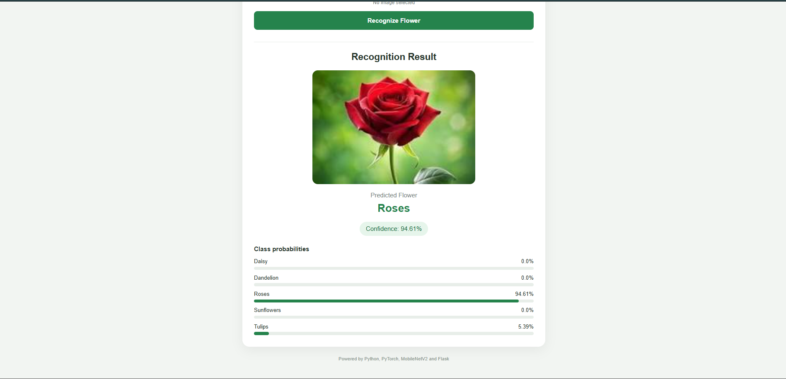
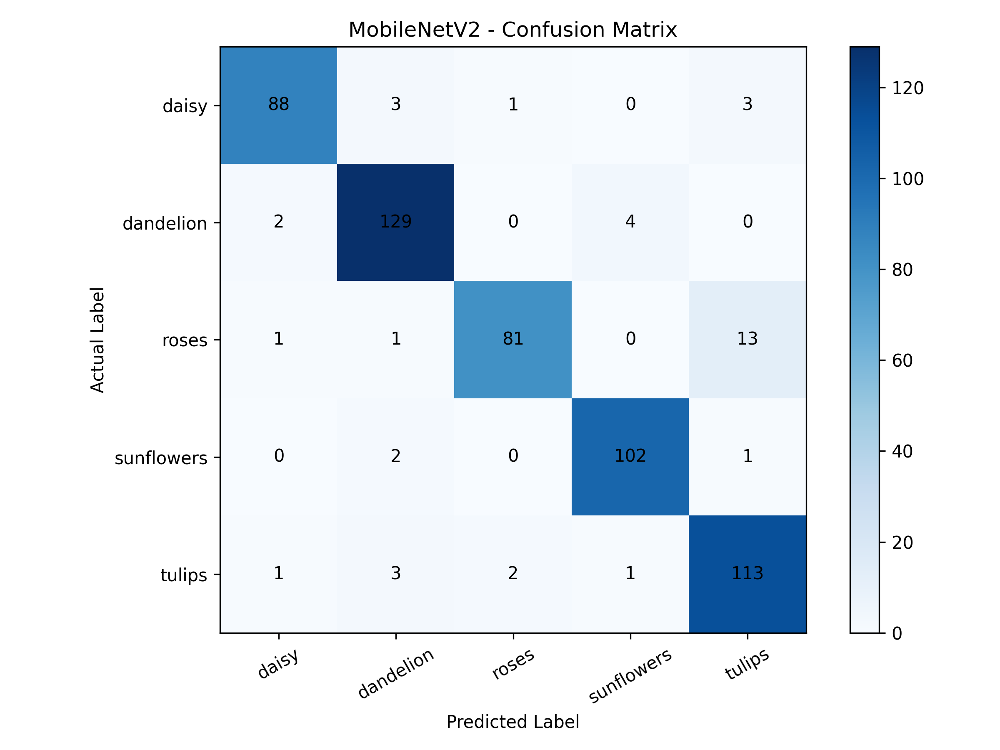

# 🌸 Flower Recognition System

A deep-learning-based image classification system that identifies five different flower categories using **PyTorch, MobileNetV2, OpenCV and Flask**.

The application allows users to upload flower images through a web interface and predicts the corresponding flower category along with its classification probabilities.

---

## 📌 Project Overview

The Flower Recognition System uses **Transfer Learning** with the MobileNetV2 convolutional neural network (CNN) architecture.

A pretrained ImageNet model is adapted to recognize five flower categories. The trained model is integrated into a Flask web application to provide image-based predictions.

### Supported Flower Categories

1. Daisy
2. Dandelion
3. Roses
4. Sunflowers
5. Tulips

---

## 🖥️ Application Homepage

The application provides a simple web interface for uploading flower images and viewing classification results.



---

## 📊 Model Evaluation

The trained model is evaluated using a separate test dataset containing 551 images.

### Confusion Matrix

The confusion matrix illustrates the classification performance across all five flower categories.



### Performance Summary

| Evaluation Metric | Result |
|---|---:|
| Validation Accuracy | 92.18% |
| Test Accuracy | 93.10% |
| Total Dataset Images | 3,670 |
| Training Images | 2,569 |
| Validation Images | 550 |
| Testing Images | 551 |
| Number of Classes | 5 |
| Input Image Size | 224 × 224 |

---

## 📂 Dataset Information

The project uses the **TensorFlow Flowers Dataset**.

Dataset source:

https://storage.googleapis.com/download.tensorflow.org/example_images/flower_photos.tgz

### Dataset Distribution

| Flower Category | Number of Images |
|---|---:|
| Daisy | 633 |
| Dandelion | 898 |
| Roses | 641 |
| Sunflowers | 699 |
| Tulips | 799 |
| **Total** | **3,670** |

### Dataset Splitting

The dataset is divided into three subsets using stratified sampling.

| Dataset | Percentage | Images |
|---|---:|---:|
| Training | 70% | 2,569 |
| Validation | 15% | 550 |
| Testing | 15% | 551 |
| **Total** | **100%** | **3,670** |

The original dataset images are not included in this repository to keep the repository size manageable.

The dataset metadata is available in:

`dataset/dataset_metadata.json`

---

## 🧠 Model Architecture

### MobileNetV2 – Transfer Learning

MobileNetV2 is a lightweight convolutional neural network designed for efficient image recognition.

The pretrained ImageNet weights are used as the starting point for the flower classification task.

### Model Configuration

- Architecture: MobileNetV2
- Pretrained weights: ImageNet
- Classification categories: 5
- Input image dimensions: 224 × 224
- Optimizer: AdamW
- Loss function: Cross Entropy Loss
- Training framework: PyTorch

### Training Strategy

**Phase 1 – Transfer Learning**

- Load pretrained MobileNetV2 weights.
- Freeze the feature extraction layers.
- Replace the original classification layer with a new five-class classifier.
- Train the new classification layer for 5 epochs.

**Phase 2 – Fine-Tuning**

- Unfreeze the final three feature blocks.
- Fine-tune the selected layers.
- Use a lower learning rate.
- Train for 10 additional epochs.

### Data Augmentation

The following augmentation techniques are applied during training:

- Random horizontal flipping
- Random rotation up to 15 degrees
- Brightness adjustment
- Contrast adjustment
- Saturation adjustment

### Image Preprocessing

- Resize images to 224 × 224 pixels.
- Convert images into tensors.
- Normalize using ImageNet mean and standard deviation.

---

## ⚙️ Technologies Used

| Technology | Purpose |
|---|---|
| Python | Main programming language |
| PyTorch | Deep learning framework |
| Torchvision | Image datasets and pretrained models |
| MobileNetV2 | Image classification architecture |
| OpenCV | Image processing |
| NumPy | Numerical operations |
| Matplotlib | Visualization |
| Scikit-learn | Dataset splitting and evaluation |
| Flask | Web application backend |
| HTML | Web page structure |
| CSS | User interface styling |

---

## 📁 Project Structure

```text
Flower-Recognition-System/
│
├── dataset/
│   └── dataset_metadata.json
│
├── models/
│   ├── flower_classifier.pth
│   ├── confusion_matrix.png
│   └── evaluation_report.txt
│
├── screenshots/
│   ├── homepage.png
│   └── confusion_matrix.png
│
├── src/
│   ├── inspect_dataset.py
│   ├── prepare_dataset.py
│   ├── train.py
│   └── evaluate.py
│
├── static/
│   ├── style.css
│   └── uploads/
│
├── templates/
│   └── index.html
│
├── app.py
├── .gitignore
└── README.md
```

---

## 🚀 Installation and Setup

### 1. Clone the Repository

```bash
git clone https://github.com/JeevanrajX/Flower-Recognition-System.git
```

Navigate to the project directory:

```bash
cd Flower-Recognition-System
```

### 2. Create a Virtual Environment

```bash
python -m venv .venv
```

Activate the environment on Windows:

```powershell
.venv\Scripts\activate
```

### 3. Install Dependencies

Install the required Python packages:

```bash
pip install torch torchvision
pip install numpy matplotlib pillow opencv-python flask scikit-learn tqdm
```

---

## ▶️ Running the Application

Once the dependencies are installed, start the Flask application:

```bash
python app.py
```

Open your browser and navigate to:

http://127.0.0.1:5000

Upload a flower image through the application interface to obtain its predicted category and classification probabilities.

**Note:** The trained model checkpoint is already included in the repository. The original dataset is required only when preparing or retraining the model, not for normal inference.

---

## 🔬 Training the Model

To reproduce the training process, first download and extract the TensorFlow Flowers dataset.

Place the extracted folder in:

```text
dataset/flower_photos/
```

Run the dataset preparation script:

```bash
python src/prepare_dataset.py
```

Train the model:

```bash
python src/train.py
```

Evaluate the trained model:

```bash
python src/evaluate.py
```

The trained model and evaluation outputs are stored in the `models/` directory.

---

## 📈 Results

The trained MobileNetV2 model achieved **93.10% test accuracy** on 551 previously unseen test images.

The evaluation report includes:

- Accuracy
- Precision
- Recall
- F1-score
- Classification report
- Confusion matrix

Detailed evaluation results are available in:

`models/evaluation_report.txt`

Confusion matrix:

`models/confusion_matrix.png`

---

## ⚠️ Limitations

- The model is trained to recognize only five flower categories.
- Non-flower images may still be classified as one of the supported flower categories.
- Prediction confidence alone does not guarantee that an uploaded image contains a flower.
- Performance may vary with image quality, lighting, backgrounds and unfamiliar flower varieties.

---

## 🔮 Future Improvements

- Introduce a non-flower image detection category.
- Expand the dataset with additional flower species.
- Improve generalization to unseen images.
- Improve prediction reliability.
- Optimize inference speed and deployment.
- Explore lightweight deployment options.

---

## 📚 References

1. TensorFlow Flowers Dataset:  
   https://storage.googleapis.com/download.tensorflow.org/example_images/flower_photos.tgz

2. PyTorch Documentation:  
   https://pytorch.org/docs/stable/index.html

3. Torchvision Documentation:  
   https://pytorch.org/vision/stable/index.html

4. MobileNetV2 Research Paper:  
   https://arxiv.org/abs/1801.04381

5. Flask Documentation:  
   https://flask.palletsprojects.com/

---

**Project:** Flower Recognition System  
**Domain:** Deep Learning and Computer Vision  
**Framework:** PyTorch and Flask  
**Model:** MobileNetV2
